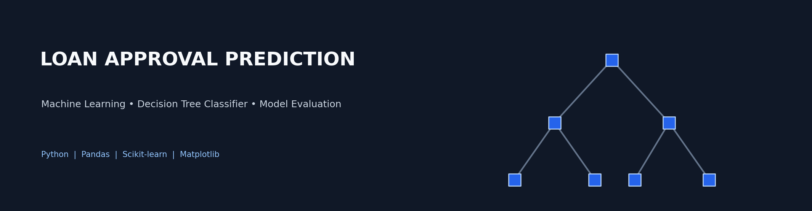
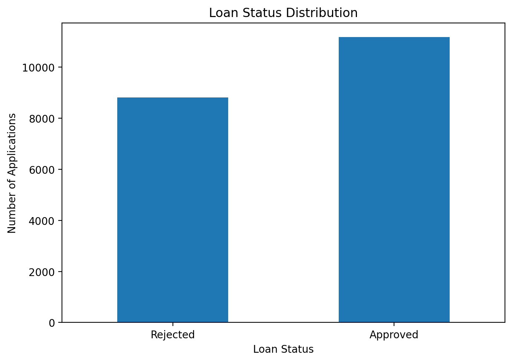
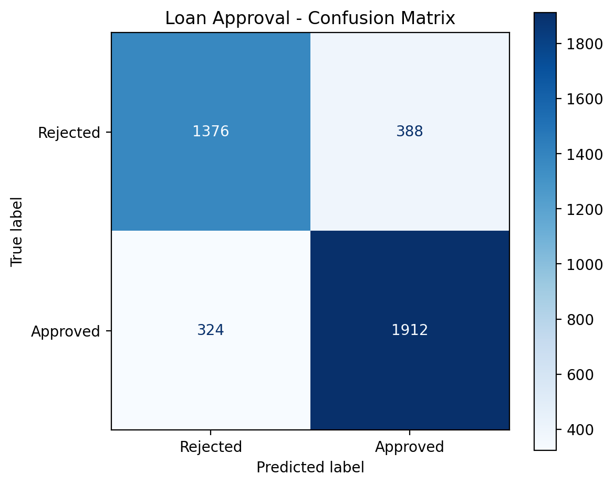
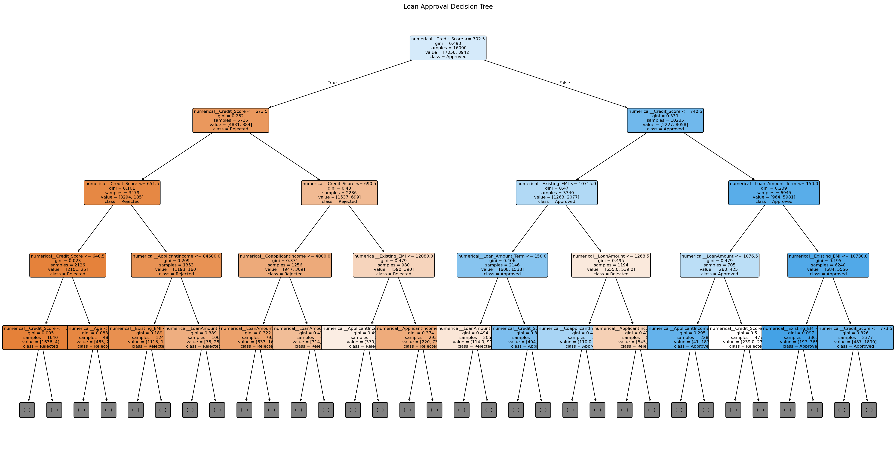
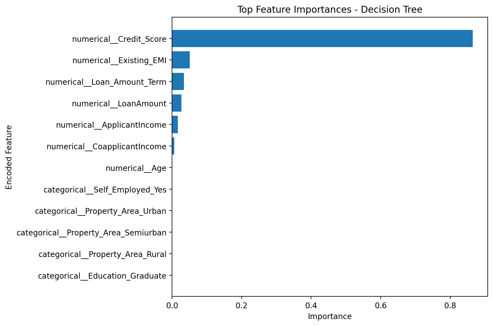
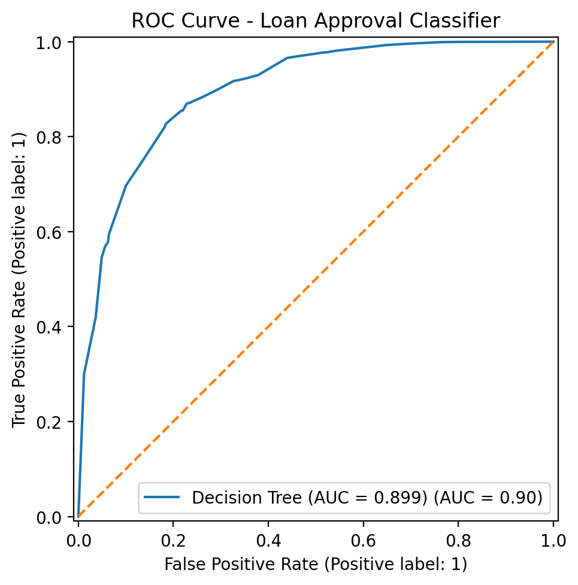
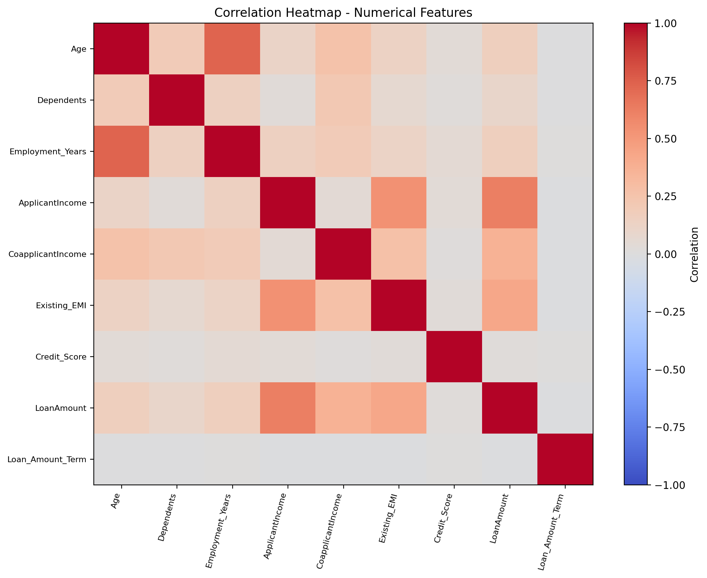
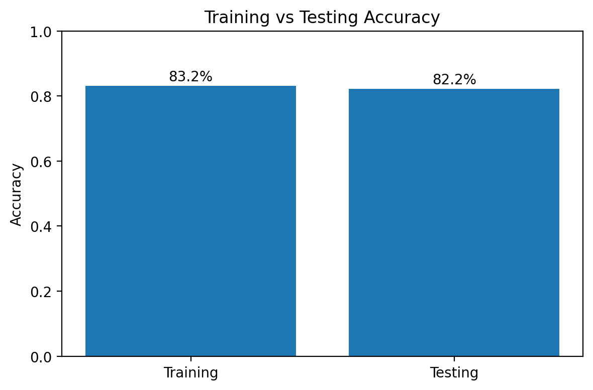
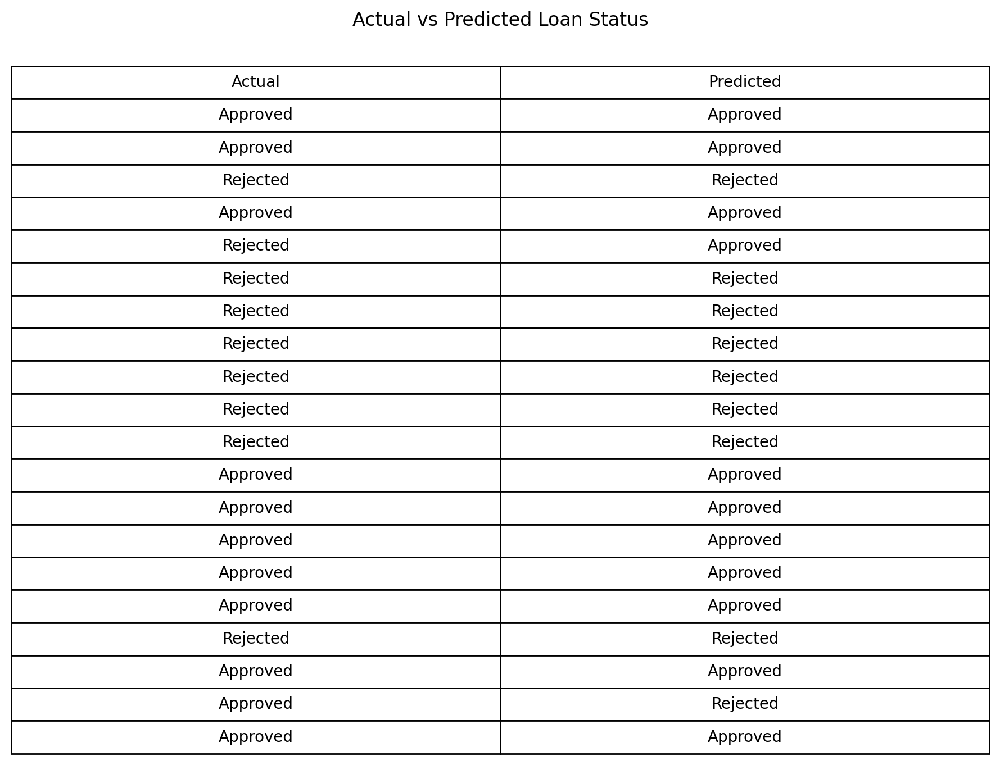

# Loan Approval Prediction | Machine Learning Project

> **A supervised machine-learning project for classifying recorded loan application outcomes using a Decision Tree pipeline.**



This repository demonstrates an end-to-end ML workflow: data preparation, categorical feature encoding, train/test splitting, model training, evaluation, and visualization. It is intended for learning, portfolio demonstration, and further experimentation—not for making real-world lending decisions.

## Project at a Glance

- **Problem type:** Binary classification
- **Model:** Decision Tree Classifier
- **Target:** `Loan_Status` (`Y` = Approved, `N` = Rejected)
- **Evaluation approach:** Stratified 80/20 train/test split
- **Preprocessing:** Numerical features passed through; categorical features one-hot encoded by the model pipeline
- **Primary tools:** Python, Pandas, NumPy, scikit-learn, Matplotlib, Jupyter Notebook

## Table of Contents

- [Project Objectives](#project-objectives)
- [Workflow](#workflow)
- [Repository Structure](#repository-structure)
- [Dataset](#dataset)
- [Results and Visualizations](#results-and-visualizations)
- [Getting Started](#getting-started)
- [Reproduce the Training Run](#reproduce-the-training-run)
- [Limitations and Responsible Use](#limitations-and-responsible-use)
- [Future Improvements](#future-improvements)
- [Author](#author)

## Project Objectives

1. Explore loan application data and understand the target distribution.
2. Prepare numerical and categorical features for machine-learning use.
3. Train a Decision Tree classifier using a reproducible train/test split.
4. Evaluate predictions with accuracy, precision, recall, F1-score, and a confusion matrix.
5. Save visualizations and model artifacts to support review and reproducibility.

## Workflow

```text
Dataset
   ↓
Data inspection and preparation
   ↓
Feature / target separation
   ↓
Stratified train-test split (80% / 20%)
   ↓
Preprocessing pipeline + Decision Tree
   ↓
Evaluation on held-out test data
   ↓
Metrics, visualizations, and saved model
```

The pipeline approach helps keep preprocessing consistent between training and prediction. `stratify=y` aims to preserve the target-class proportions in both subsets; it does not force the classes to be equally balanced.

## Repository Structure

```text
loan-approval-prediction/
├── assets/                 # Saved plots for project documentation
├── dataset/                # Dataset instructions (CSV not included)
├── models/                 # Saved model artifact and notes
├── notebooks/              # Exploratory analysis and model notebook
├── src/                    # Reusable training/evaluation script
├── static/                 # Static web assets, if a web UI is added
├── templates/              # HTML templates, if a web UI is added
├── .gitignore
├── requirements.txt
└── README.md
```

## Dataset

The notebook and training script expect the dataset at:

```text
dataset/loan_approval_dataset.csv
```

The CSV is not included in this repository. Add it locally from a legitimate source and verify its license and redistribution permissions before publishing it. Do not commit private, confidential, or personally identifiable applicant data.

The target mapping used in the project is:

| Source value | Encoded value | Meaning |
|---|---:|---|
| `N` | `0` | Rejected |
| `Y` | `1` | Approved |

The current notebook excludes `Loan_ID`, `Gender`, and `Married` from the input features. Excluding those columns alone does **not** establish fairness: other variables can act as proxies for sensitive attributes, so fairness requires separate analysis.

## Results and Visualizations

The reproducible training script currently reports **82.20% test accuracy** and **83.17% training accuracy** on the supplied dataset, using a stratified 80/20 split and `random_state=42`. Treat these as dataset-specific results, not a guarantee of performance on new applicants. Re-running with different data or preprocessing can change the metrics.

### Loan Status Distribution



### Confusion Matrix



### Decision Tree Structure



### Feature Importance



### ROC Curve



### Numerical Feature Correlations



### Training vs Testing Accuracy



### Sample Predictions



These images are generated from the dataset and a reproducible 80/20 stratified split by running `python src/train.py`. Results describe this dataset and run only; they do not guarantee performance on new applicants.

Accuracy should not be used alone to assess a classifier. Review precision, recall, F1-score, class balance, and the types of errors made by the model.

## Getting Started

### 1. Clone the repository

```bash
git clone https://github.com/YOUR_USERNAME/loan-approval-prediction.git
cd loan-approval-prediction
```

### 2. Create and activate a virtual environment

**Windows PowerShell**

```powershell
python -m venv .venv
.venv\Scripts\Activate.ps1
```

**macOS / Linux**

```bash
python3 -m venv .venv
source .venv/bin/activate
```

### 3. Install dependencies

```bash
python -m pip install --upgrade pip
python -m pip install -r requirements.txt
```

### 4. Add the dataset

Place the permitted CSV file at `dataset/loan_approval_dataset.csv`.

## Reproduce the Training Run

From the repository root, run:

```bash
python src/train.py
```

The script is intended to train and evaluate the pipeline, save a model artifact, and write evaluation visualizations. Check the console output and generated files to confirm a successful run in your environment.

You can also open `notebooks/loan_approval_prediction.ipynb` in VS Code or Jupyter and execute its cells in order after adding the dataset.

## Model Artifact Compatibility

The repository includes the supplied `decision_tree_project.pkl` file under `models/`. Pickle/joblib model files can be sensitive to Python and scikit-learn version differences. The supplied artifact previously failed to load in a different test environment because of a scikit-learn internal compatibility issue. If loading fails, use the environment/version used for training or retrain from the notebook/script and save a fresh artifact.

**Security note:** Only load pickle/joblib files from sources you trust; loading an untrusted serialized model can execute arbitrary code.

## Limitations and Responsible Use

- This is an educational prototype, not a validated credit-risk or lending system.
- The model learns patterns in historical data and can reproduce biases present in that data.
- A test score alone does not establish reliability, calibration, fairness, or generalization to new applicants.
- Real lending use would require appropriate legal and compliance review, data governance, robust validation, privacy safeguards, monitoring, and documented fairness testing.
- Do not use the output as the sole basis for approving or rejecting a real person's loan application.

## Future Improvements

- Compare the Decision Tree with Logistic Regression and Random Forest baselines.
- Add cross-validation and a documented hyperparameter search.
- Include per-class metrics and error analysis across relevant groups where legally and ethically appropriate.
- Add explainability and calibration analysis.
- Add automated tests for preprocessing, model loading, and prediction inputs.
- Build and deploy a Flask interface only after confirming the model's input schema and artifact compatibility.

## Author

**Your Name**  
GitHub: `https://github.com/YOUR_USERNAME`

> Before publishing, replace the author placeholders with your preferred public profile details and confirm that no private data or credentials are included.

## License

No license is specified yet. Add a `LICENSE` file before inviting others to reuse, modify, or distribute this project. Choose a license that matches your intentions and any dataset/model restrictions.
